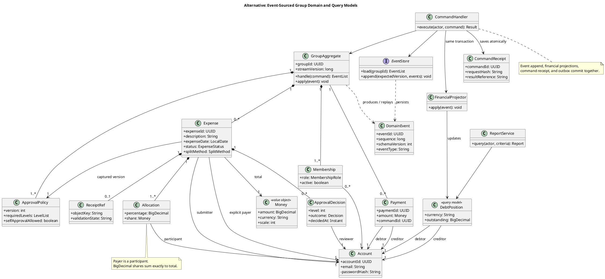
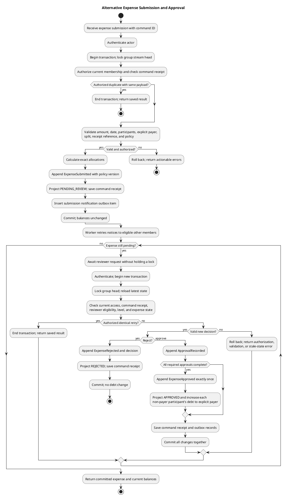
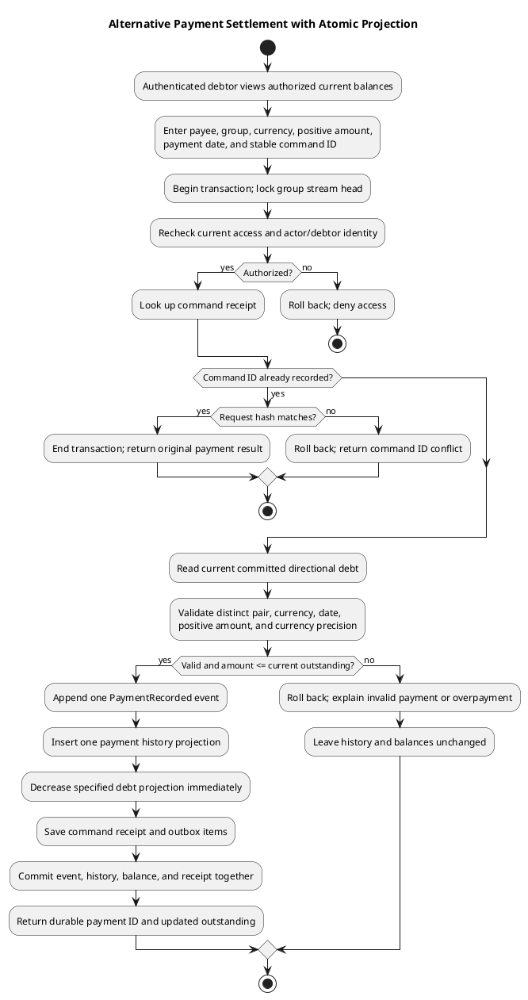
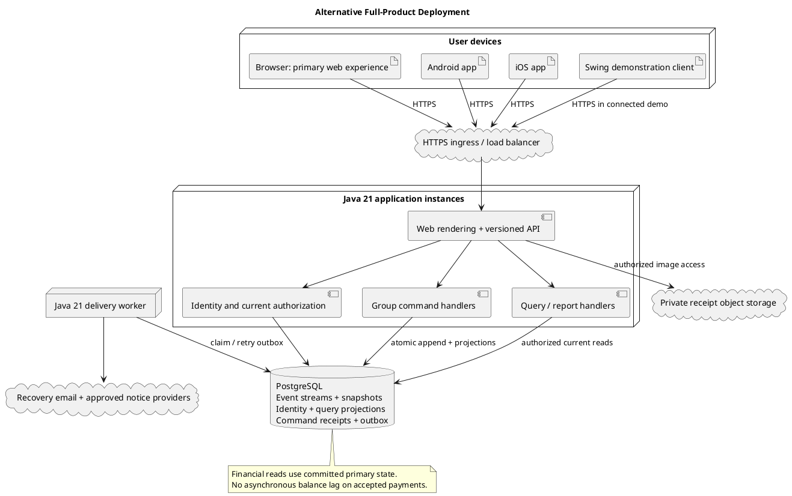

# SplitSmart Alternative Architecture — CIS 285 Lab 7

**Date:** 2026-11-04  
**Status:** Independent design proposal for human review; no implementation or product approval implied.

## 1. Approach, rationale, and scope

Use an **event-sourced, group-oriented command/query architecture (CQRS)**. Each group is a consistency boundary: commands load its state, check current authorization and domain rules, and append immutable business events. Query models provide expense details, pairwise balances, notifications, and reports. Deploy the command and query handlers together initially; CQRS does not require microservices, a message broker, or separate databases.

This alternative starts with the need to explain every approval and settlement, recover state after failures, and prevent concurrent payments from exceeding a debt. An ordered group event stream provides an explicit history; synchronous financial projections provide immediately correct balances. It is independently proposed rather than a revision of the Spec Kit baseline. Its suitability must be weighed against its additional complexity for a small course project.

### Sources and authority

Read alongside [UserRequirement.md](../../UserRequirement.md), [constitution.md](../../.specify/memory/constitution.md), [spec.md](./spec.md), and [requirements.md](./requirements.md). Baseline comparison uses [architecture.md](./architecture.md), [plan.md](./plan.md), [research.md](./research.md), [data-model.md](./data-model.md), [service-contract.md](./contracts/service-contract.md), [quickstart.md](./quickstart.md), and the existing `diagrams/` sources. Those artifacts remain unchanged.

Customer outcomes remain authoritative. Event sourcing, CQRS, PostgreSQL, group serialization, and client delivery choices below are proposed implementation decisions. The five confirmed clarifications remain binding:

1. An expense has exactly one explicit payer among its participants; payer and submitter may differ.
2. Only the group creator/designated administrators add or remove members. Removal revokes group-record access while preserving history for current authorized members.
3. Amounts are positive and conform to supported currency precision. Percentages are nonnegative and total exactly 100%. Allocate leftover smallest currency units by largest fractional remainder with a consistent tie-break.
4. Sign-in uses email/password and password recovery uses email.
5. Full or partial payments up to outstanding debt apply immediately to the specified payer–payee balance and are recorded exactly once; reject overpayments.

### Requirements coverage

| Requirements | Alternative design responsibility and acceptance evidence |
|---|---|
| FR-001–FR-002: accounts and personal information | Identity component, email recovery, authenticated command/query gateway; AC-001 account isolation and recovery tests |
| FR-003: groups | Group aggregate, membership roles, current-access checks; AC-002 administrator-only membership changes and removal tests |
| FR-004–FR-006: expenses, splits, receipts | Expense state, allocation policy, protected receipt store; AC-003 exact shares, explicit payer, invalid-input, and receipt tests |
| FR-007: notifications | Submission event, transactional outbox, durable in-app inbox and delivery worker; AC-004 recipient/privacy tests |
| FR-008: single/multiple approval levels | Versioned approval policy and approval decisions; AC-005 pending/rejected isolation and final approval tests |
| FR-009–FR-010: balances and settlements | Synchronous debt projection and serialized settlement command; AC-006 partial/full payment, overpayment, concurrency, and retry tests |
| FR-011: filtered reports | Authorized query service over current projections and immutable financial facts; AC-007 source-record reconciliation and date validation |
| FR-012: web, Android, iOS | Separate required platform experiences using one authoritative backend; AC-008 equivalent journeys on all three |
| NFR-001–NFR-006 | Exact monetary reconciliation, authorization, agreed performance measurement, platform parity, actionable validation, and durable committed history; AC-003 and AC-008–AC-010 |

The complete product retains every feature, including configurable single/multiple review levels, optional receipts, notifications, and date/parameter reporting. An MVP omission is a delivery gap, never removal from this inventory.

## 2. Components and responsibilities

| Component | Responsibility and boundary |
|---|---|
| Presentation adapters | Swing desktop, server-rendered web, Android app, and iOS app collect input and render results; none is authoritative for money, approval, or access rules. |
| Identity/session component | Register accounts, verify password hashes, issue/revoke sessions, and send single-use expiring recovery links by email. Credentials are outside group event streams. |
| Command gateway | Resolve actor from session, validate request shape, enforce idempotency, and dispatch commands such as SubmitExpense, DecideExpense, RecordPayment, and RemoveMember. |
| Group command handler | Begin transaction, lock group stream head, rehydrate aggregate, enforce authorization and policy, generate events, and commit all related state. No network calls inside the transaction. |
| Group aggregate/domain policies | Own membership, versioned approval rules, expense workflow, allocation invariants, and debt limits. Ordinary Java objects; no UI, HTTP, or database dependencies. |
| Event store | Append versioned, ordered events with optimistic uniqueness checks and durable transaction support. The business history is authoritative; snapshots are disposable acceleration data. |
| Synchronous projection handlers | Apply events to expense, decision, payment, membership, and debt query tables in the same transaction as event append. A successful response therefore implies immediately queryable financial effects. |
| Query/report service | Authorize every query using current membership, filter date/other supported parameters, and return consistent database snapshots. Never rely on authorization captured in an old event. |
| Receipt adapter | Validate image type/size/content, retain private image objects and metadata, and serve bytes only after current authorization. Clean up orphaned staged uploads. |
| Outbox/inbox worker | Retry committed expense-submission notices, persist one inbox item per recipient/event, recheck current access, and optionally call approved external channels. Notification failure does not undo expense submission. |

A group stream is a logical serialization boundary, not a permanently running thread or a separately deployed service. Independent groups execute concurrently across backend instances. Cross-group personal summaries combine authorized query rows; commands do not perform cross-group money transfers.

## 3. Data model and domain classes

Use one PostgreSQL database initially, with separate event, identity, and query schemas. IDs are stable opaque identifiers. Foreign keys, uniqueness constraints, and explicit transactions enforce integrity in addition to domain checks.

| Class / record | Important fields and behavior |
|---|---|
| Account | accountId, normalized unique email, passwordHash, status; identity lifecycle and recovery references |
| GroupAggregate | groupId, creatorId, streamVersion, memberships, policy versions, expense states, debt positions; accepts commands and applies events |
| Membership | accountId, role, active, joinedAt, removedAt; removal preserves historical identity references |
| ApprovalPolicy | policyId, version, ordered required levels, reviewer eligibility, selfApprovalAllowed; expense captures policy version at submission |
| Expense | expenseId, submitterId, payerId, Money total, expenseDate, description, splitMethod, status, policyVersion; contains allocations and decisions |
| Allocation | participantId, optional BigDecimal percentage, Money share, remainder rank; payer must be a participant |
| ApprovalDecision | decisionId, reviewerId, level, outcome, decidedAt; immutable, eligible, and valid for current workflow state |
| Money / AllocationPolicy | BigDecimal amount plus currency/scale; exact validation and largest-remainder allocation |
| ReceiptRef | receiptId, expenseId, private object key, mediaType, byteLength, content hash, validation state |
| DebtPosition | groupId, currency, debtorId, creditorId, BigDecimal outstanding; approved allocations increase it and payments decrease it |
| Payment | paymentId, debtorId, creditorId, Money amount, paidAt, recordedAt, actorId, commandId; records a reported payment, not a bank transfer |
| DomainEvent | eventId, groupId, sequence, eventType, schemaVersion, commandId, actorId, occurredAt, payload |
| CommandReceipt | actorId, groupId, commandId, requestHash, response references; retry deduplication and payload-conflict detection |
| Notification / OutboxItem | eventId, recipientId, delivery status, attempt metadata; unique event/recipient/channel prevents duplicate inbox items |
| ReportCriteria | date range, optional group and supported filters; request value with authorization applied independently |

Example event types are GroupCreated, MemberAdded, MemberRemoved, ExpenseSubmitted, ApprovalRecorded, ExpenseRejected, ExpenseApproved, and PaymentRecorded. ExpenseSubmitted carries final validated allocations, explicit payer, receipt reference, and policy version. ExpenseApproved references those frozen allocations. PaymentRecorded contains the exact accepted amount and debt pair. Avoid a second independently authoritative ledger: the event history and its deterministic projections replace the baseline's canonical posting model.

### Persistence and consistency rules

- Enforce unique `(groupId, sequence)` and event IDs. Every group mutation locks the same stream-head row, including membership removal. A final approval creates one ExpenseApproved event, guarded by state and expense identity. Pending/rejected expenses create no debt effects.
- A command transaction atomically appends events, advances the stream version, updates authoritative financial/access projections, saves its CommandReceipt, and inserts outbox items. Roll back all of these on failure. Reply only after durable commit.
- Replay begins from events or a verified versioned snapshot. Snapshot state includes membership, policies, pending workflows, and debt positions; corruption permits rebuild from retained events. Historical replay uses recorded allocations rather than recalculating with today's policy.
- Debt rows use `(groupId, currency, debtorId, creditorId)` keys. Each non-payer participant owes their allocated share to the explicit payer; the payer's own share creates no self-debt. Keep directional pairs separate initially; reciprocal netting is a product-policy question and must not silently change payment validation. Cross-group/cross-currency netting is not assumed.
- Money uses BigDecimal throughout Java and exact database decimal columns at approved precision. Transport amounts/percentages as decimal strings with currency codes. No binary floating-point money. Reject excess precision rather than silently changing submitted amounts.
- Allocate equal or percentage shares by flooring exact nonnegative shares to currency scale, then distributing remaining units by descending fractional remainder. **Proposed, unconfirmed tie-break:** participant ID ascending. Persist final shares and policy version. Supported currencies/scale and tie-break selection still require product input.
- CommandReceipt uniqueness is scoped to actor/group/command ID. Check authorization, then deduplicate **before current debt validation**: a retry after a successful full settlement must return the saved payment instead of failing because debt is now zero. A reused ID with different content is a conflict. Financial uniqueness guards remain durable; retention is a separate policy decision.
- Reports read expense/payment facts and debt projections transactionally, with explicit date semantics: expense date for spending, paidAt for payment history, and current balances labeled current. Any historical/as-of balance option must derive from defined financial effective dates and disclose its cutoff. Reject invalid date ranges; unspecified filters/exports remain open.
- Membership removal revokes API, report, inbox, and receipt access at the serialized removal point. Events and historical obligations remain available to current authorized members. Already downloaded data cannot be remotely erased; minimize client caching. Rules for settling obligations involving a removed member remain unresolved, rather than granting the removed account renewed access.

### PlantUML class diagram

## 4. Expense approval activity

Each reviewer decision is a separate short request/transaction; never hold a database lock while awaiting human review. Snapshot the group's policy at submission. The specification's default forbids self-approval unless the policy explicitly permits it. Policy administration and eligible reviewer rules remain product decisions.

Notifications originate at submission, not just final approval. An unavailable notification provider does not block review. A duplicate, late approval, or approval after rejection cannot produce another balance effect. If no eligible reviewer exists, the expense stays pending and exposes the policy problem; it is never auto-approved.

## 5. Payment settlement activity

Record an already made payment; this architecture introduces no payment processor. Serialize against the same group stream as approvals and membership changes. Validate the latest debt under that lock, not a balance previously displayed by a client.

If two clients both attempt to settle the last outstanding amount, only the first valid transaction succeeds; the next reloads the lower debt and rejects overpayment. If commit succeeds but the response is lost, the same command ID returns the existing payment. A transaction failure creates neither a payment nor a balance change. Durable exactly-once financial records do not imply exactly-once delivery through external email/push providers.

## 6. Deployment for the complete product

Deploy a Java 21 backend with command and query adapters behind HTTPS ingress, initially as one service deployment with a separate worker process from the same codebase. PostgreSQL is the transactional source; private object storage holds receipt images. Multiple stateless service instances share database-backed stream locks and command receipts, rather than relying on in-memory locks.

The primary web experience is server-rendered by Java, using standard HTML forms and accessible responsive pages. Android and iOS require separately distributed app experiences connected to this backend. A proposed Java-compatible mobile route uses a Java UI toolkit/compiler targeting Android and iOS; a feasibility spike must verify Java 21 language/API compatibility, iOS signing/distribution, accessibility, secure credential storage, receipt capture, and notifications. Maven remains the build/dependency/test entry point; any required target packager runs through a documented Maven build profile. Mobile clients never execute the authoritative financial engine.

This is a deployment design, not evidence that a mobile toolchain already meets those constraints. No specific mobile toolkit or unsupported compatibility claim is adopted. If feasibility fails, propose another compatible client approach or obtain a constitution amendment before adopting non-Java application code. Browser access on a phone or a Swing window is insufficient evidence of delivering Android/iOS apps. Exact supported versions and release parity remain product decisions; FR-012 cannot pass until actual app journeys are demonstrated.

Use encrypted transport/storage, restricted network paths, managed secrets, database backups and tested restoration. Monitor command latency, group lock waits, projection consistency, worker backlog, and delivery failures. Define availability, recovery objectives, provider selection, workload, and deployment rollback procedures before production acceptance. Roll back application versions only if event/schema compatibility is established.

## 7. Java 21, Maven, and Swing MVP

Unlike the baseline's local-only desktop, this alternative proposes a **connected Swing MVP**: Swing talks to a Java 21 service, with PostgreSQL and a worker running on a development workstation or private lab host. Several demo accounts can use the same data. A single workstation may host client and service, but Swing never opens database tables directly. Network/service setup is an explicit added cost; offline financial writes are outside the proposed MVP.

Use a Maven reactor with proposed modules `domain`, `application`, `persistence`, `delivery`, and `desktop`. Compile governed Java application code for release 21 and pin project dependency/plugin versions. Maven runs JUnit 5 checks and packaging; target-specific desktop packaging can later use Java 21 jpackage. These are proposed module names only; this document creates no build or source files.

Swing forms delegate to client/application adapters. HTTP and file work run off the Event Dispatch Thread; UI changes return to it. Immutable response models display server-computed allocations and balances. Java BigDecimal stays in the backend financial domain, and any desktop monetary formatting preserves exact decimals. The desktop does not duplicate approval, settlement, or authorization rules.

The proposed lab demonstration covers sign-in, administrator membership changes, both split methods, optional receipt upload, configurable review, in-app submission notices, balances, partial/full settlement, reports, and restart durability. Email recovery needs an actual mail adapter and verifiable recovery flow; a simulated message demonstrates a UI path only. External notification channels and production operations remain dependent on approved choices.

**Scope boundary:** a connected desktop still does not satisfy FR-012. The web interface, Android app, and iOS app are separate required deliveries with independent acceptance evidence. Demonstrated collaboration does not establish complete production security or platform compliance. Any smaller lab slice must identify its omissions in review/release notes. This alternative does not change the baseline MVP's approved scope or replace its files.

## 8. Quality attributes and verification

### Security

Use adaptive salted password hashing, rate-limited sign-in/recovery, expiring single-use hashed recovery tokens, generic recovery responses, and session revocation after appropriate identity changes. Never store passwords or recovery tokens in events, logs, or projections. Derive actor IDs from authenticated sessions. Apply current object/group authorization to commands, reports, inbox items, and receipt retrieval, including duplicate-request responses. Server-rendered forms require CSRF protection and secure session cookies; mobile/desktop sessions need protected device storage.

Validate receipt bytes as well as declared media type, isolate untrusted objects, and enforce approved size/type/access policies. Prefer service-mediated image access so removal takes effect immediately; already issued long-lived object links would undermine that boundary. Minimize private data in outbox messages and recheck membership before delivery. A membership removal racing with an already sent external notification cannot retract that message; omit sensitive financial details from external payloads.

Event immutability complicates erasure/retention. Store profile/credential data outside immutable business payloads and reference opaque account IDs where possible. Access restrictions, account deletion, retention periods, and any permitted redaction/crypto-erasure require explicit policy; do not invent a retention obligation or promise unrestricted replay after mandated deletion.

### Scalability and performance

Different groups process concurrently. A single busy group is serialized and can become a hotspot; bound transaction duration, index stream/version and query keys, and use snapshots to avoid repeatedly replaying long histories. Receipt bytes stay outside the database. Stream report results with pagination and authorization constraints.

Keep money, expense state, payment history, and access projections synchronous. Optional delivery statistics or future analytics can be asynchronous and visibly labeled with freshness. Rebuild projections into shadow tables and compare totals/versions before an atomic cutover; rebuilding must not resend notifications. Do not serve stale replica balances after acknowledging a payment. Add read replicas or independent services only when measurements justify their consistency and operations costs.

The specification's proposed target remains 95% of ordinary actions within three seconds on every required platform under agreed conditions. Event sourcing does not prove that target. Measure normal actions, replay costs, lock contention, report sizes, and worker backlog with a stakeholder-approved workload; group size, throughput, and availability targets remain unspecified.

### Maintainability

Keep pure domain policies separate from serialization, SQL, UI, and network adapters. Version event schemas, preserve old-event readers/upcasters, and test replay across upgrades. Do not rewrite historic allocations when rounding policy changes. Document command/query contracts and preserve decimal-string transport, structured field/action errors, authentication, and retry-safe mutations from the baseline contract where compatible; event sourcing remains an internal choice.

Compile-time Maven boundaries make dependencies reviewable but add build overhead. Update these PlantUML sources with architectural changes. Maintain requirement-to-test traceability and obtain human review before this AI-assisted proposal becomes authoritative. No constitution exception is assumed; the constitution's unresolved ratification-date placeholder is unchanged.

### Testing plan (future implementation)

| Level | Meaningful checks and required evidence |
|---|---|
| JUnit 5 domain tests | Explicit payer differs from submitter; payer among participants; positive/precision validation; equal and percentage splits; 100 valid allocation examples reconcile exactly; nonnegative percentages total exactly 100%; largest-remainder ties. |
| JUnit 5 workflow tests | Pending/rejected expenses never change debt; single/multiple required levels; self-approval default; unauthorized/out-of-order/duplicate decisions; only final approval has financial effect. |
| Database integration tests | Rollback between event/projection writes; two concurrent final approvals; simultaneous payments; approval racing with payment; membership removal racing with commands; durable command deduplication and different-payload conflict. |
| Replay and recovery tests | Rebuild projections and compare exact balances/history with live state; old event schemas; snapshot failure; crash after commit before response; failed worker delivery and restart; no delivery during rebuild. |
| Security and adapter tests | Account isolation, recovery token expiry/reuse, admin-only membership changes, removed-member direct-ID/report/receipt/inbox denial, image validation, and actionable errors without partial writes. |
| Contract/platform acceptance | Equivalent authorized account, submission, approval, balance, settlement, receipt, notification, and report journeys on web/Android/iOS; decimal transport; same-command retry after full settlement; real email recovery. |
| Operational acceptance | Persistence across later sign-in, backup/restore reconciliation, approved-load performance measurements, and failed-provider recovery. |

Core business checks run without Swing. The future build gate is Maven verify with JUnit 5; this documentation task runs no Java tests and claims no runtime or platform validation.

## 9. Comparison with the Spec Kit baseline

The baseline itself already uses immutable financial postings, atomic approval/payment updates, and an outbox. Auditability and retry safety are therefore shared goals; the difference is that this alternative makes domain events the reconstructable source of group state rather than ordinary entity tables plus ledger postings.

| Concern | Existing baseline | Independent alternative and tradeoff |
|---|---|---|
| Lab MVP | Swing plus local SQLite, one workstation dataset | Swing plus shared Java service/PostgreSQL; genuine shared lab data, but more installation, networking, and operational effort |
| Full-product organization | Modular monolith, application services and repository ports | Group command model plus separate query projections, initially co-deployed; explicit command consistency at greater conceptual cost |
| Authoritative history | Entity state and immutable debt/payment postings | Ordered domain events including workflow/membership history; broader reconstruction capability but event evolution and privacy costs |
| Read path | Queries/aggregation over canonical tables/postings | Purpose-built synchronous projections; efficient reads and easy reconciliation, but duplicate representations must remain consistent |
| Concurrent writes | Serialize affected debt position as needed | Serialize all commands for a group; simpler ordering across membership, approval, and settlement, but a busy group limits throughput |
| Build structure | One Maven project, package boundaries | Maven modules, enforceable dependency boundaries, additional build configuration |
| Failure recovery | Restore canonical data and recompute balances from postings | Restore events, replay workflow/query state, verify projections; powerful repair mechanism but requires tested replay tools |
| Platform delivery | Future Java API and separate required clients | Java API plus Java-rendered primary web and Java-compatible mobile delivery proposal; mobile feasibility/signing remains an explicit gate |
| Financial consistency | Atomic ledger/state changes | Atomic events/projections/command receipts; no intentional eventual consistency in accepted payments or current balances |
| Operations | Minimal local MVP; service operations later | Service/database operations in MVP; catches collaboration problems sooner but increases lab scope |

**Advantages:** richer audit of workflow decisions, deterministic state reconstruction, query models shaped for reports, and one ordering boundary for access and financial commands. A connected MVP can exercise retries and multi-client conflicts early.

**Disadvantages:** event/schema migration, replay, snapshots, and projection management introduce complexity beyond a CRUD-oriented course app. Group serialization can reduce throughput. Immutable history increases retention-policy work. Connected demonstrations require a running service and database.

**Decision tradeoff:** prefer this alternative if recoverable workflow history and concurrent collaboration are central learning/evaluation goals. Prefer the baseline for a smaller local desktop exercise with lower operating cost. No measured scale requirement currently mandates event sourcing, distributed services, or this module structure; choosing this proposal requires human design review rather than a claim that it is universally better.

## 10. Unresolved decisions and acceptance boundary

Keep the specification's open questions open: currencies/precision and cross-currency behavior; additional account safeguards; group/policy administration and reviewer eligibility/order; notification channels/preferences; report filters/exports/sharing; receipt formats/limits/retention/access; browser/mobile versions and initial feature parity; final Swing MVP scope; normal operating load/availability/timing conditions; and the exact deterministic remainder tie-break. Account deletion/retention and handling outstanding obligations after membership removal also need product rules.

Alternative-specific technical decisions requiring validation are mobile Java 21 compatibility and distribution, event schema evolution, snapshot/rebuild operations, command-receipt retention, host/provider selection, and group-contention limits. None is a confirmed customer clarification. This document preserves all requirements, proposes no waiver, and supplies design artifacts only; it creates no Java code or claim of implemented conformance.
